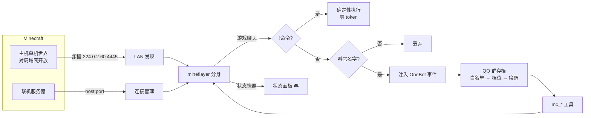

# MC Bot · 我的世界分身

> 给你的 QQ 机器人一个**独立的 Minecraft 玩家分身**：主机开的世界它自己进来，平时自己玩，QQ 群和游戏聊天框都能指挥它——而**它自己玩的时候一个 token 都不花**。

[](https://github.com/37dushine/qqagent-skill-mcbot/actions/workflows/ci.yml)
[](LICENSE)
[](https://nodejs.org)
[](#安装)

这是一个 [QQ Agent](https://github.com/Kondius/qq-agent) 的**技能（skill）**，不是独立程序。装上之后，你的机器人在 Minecraft 里会多出一个真正的玩家：有名字、有坐标、有血量，会走动、会躲怪、会跑去看村庄，也会听你的话去挖一块指定的石头。

```
QQ 群 ──自然语言──┐
                  ├──▶ 模型（按需唤醒）──▶ mc_* 工具 ──▶ 分身 ──▶ Minecraft
游戏聊天框 ─!命令──┘                                      ▲
        └─叫名字──────────────────────────────────────────┘

分身自己玩（走动/张望/躲怪/捡东西/看村庄）──▶ 确定性代码，零 token
```

---

## 它到底能干什么

| 能力 | 说明 |
|---|---|
| **自动加入局域网世界** | 主机用 PCL / 官方启动器进单机世界后点一下「对局域网开放」，分身在几秒内自己进同一个世界。主机关世界它就退场，不打扰主机 |
| **独立玩家身份** | 基于 [mineflayer](https://github.com/PrismarineJS/mineflayer)，是一个真正的 MC 协议客户端，不是外挂、不改主机存档，主机照常玩 |
| **联机服务器** | 填地址端口即可常驻；掉线自动重连（可关） |
| **自己玩（零 token）** | 空闲时按权重抽一件事做：到处走走 / 原地张望 / 小跑 / 蹦跶 / 凑近看玩家 / 捡掉落物 / 观察动物 / 探索村庄营地 / 砍一块木头（默认关） |
| **遇怪逃跑** | 24 格内出现敌对生物，其他行为全部让位，反向跑开 26 格 |
| **游戏内 `!` 命令** | `!来` `!跟随` `!停` `!状态` `!帮助`，确定性执行、游戏内秒回，零 token |
| **叫名字才唤醒** | 游戏聊天里叫它名字，消息会以「被 @" 的口径注入绑定 QQ 群，和其它 QQ 消息走**同一套**响应档位与白名单 |
| **双向聊天** | 可选把游戏聊天镜像到 QQ 群；也能让它在游戏里说话（`mc_chat`） |
| **见闻记忆** | 自己玩的时候把看到的东西记在内存（最近 12 条），问它「你刚才干嘛了」能照实答 |
| **热重载安全** | 连接、定时器、统计挂在 `globalThis` 上，技能重载不会断线重连 |

### 它绝不会做的事

- **不攻击任何生物或玩家** —— 代码里没有攻击路径，看到怪只会跑
- **不破坏地形** —— 挖方块、砍树各有独立开关，默认都关；只有你明确下指令才动手
- **不刷屏** —— 自言自语每小时最多 3 句，主动汇报默认关且有频率上限
- **不绕过权限** —— QQ 侧沿用宿主的 `allow` / `deny` 白名单判定

---

## 安装

### 方式一：脚本

```bash
git clone https://github.com/37dushine/qqagent-skill-mcbot.git
cd qqagent-skill-mcbot
node scripts/install.mjs --app "<QQ Agent 安装目录>/resources/app"
```

Windows 下路径形如 `D:\QQagent\QQ Agent\resources\app`（就是包含 `src/`、`skills/`、`plugins/` 的那个目录）。

脚本会：校验目标 → 备份旧版本到 `app/.mc-bot-backup/` → 拷 3 个文件 → 语法检查 → 缺依赖时在 app 根执行 `npm install`。

### 方式二：手动

```bash
cp skill/skill.json skill/index.js skill/host.js "<app>/skills/mc-bot/"
cd "<app>" && npm install mineflayer mineflayer-pathfinder vec3
```

> **依赖必须装在 app 根目录**（`<app>/node_modules`），不是技能目录里——技能是靠 Node 的向上查找拿到 `mineflayer` 的。QQ Agent **重装/升级会清掉** `node_modules`，重新执行一次 `npm install` 即可。

装好后打开 QQ Agent：**「技能」页**多出「我的世界分身（MC Bot）」，开关默认打开，点进去有 20 项设置。QQ Agent 开着热重载，**不需要重启**。

---

## 快速开始（单机 + PCL）

1. PCL 启动游戏，进你的单机世界
2. 按 **Esc → 对局域网开放**（不用改任何选项，点一下就行）
3. 等几秒，分身在 QQ 群发一句「我进游戏了」，然后开始自己玩
4. 关掉世界，它自动退场；下次再开放它会再进来

**全程不需要任何额外操作。** 联机服务器则是在设置里填地址端口，或直接在群里说「连 mc.example.com」。

---

## 三种指挥方式

| 入口 | 怎么用 | 花 token |
|---|---|---|
| **QQ 群说人话** | 「去 100 64 200」「跟着 Steve」「你刚才干嘛了」 | 会（你主动找它说话） |
| **游戏里叫名字** | 游戏聊天框发「小明 过来一下」 | 会（只有叫名字才唤醒） |
| **游戏内 `!` 命令** | `!来` `!跟随 [名字]` `!停` `!状态` `!帮助` | **不会**，秒回 |

> 两个聊天框默认**不通**：你在 QQ 群说话，游戏里的人听不见。要让游戏里的人看到，就说「在游戏里说 xxx」（走 `mc_chat`）；想让游戏聊天进 QQ，开「游戏聊天镜像到 QQ 群」。

---

## 模型可调用的工具（8 个）

| 工具 | 用途 | 主要参数 |
|---|---|---|
| `mc_control` | 上线 / 下线 / 查状态 | `action`（status/connect/disconnect）、`host`、`port`、`version` |
| `mc_observe` | **一次给全**态势：位置、血量、玩家、怪物、背包、见闻 | 无 |
| `mc_chat` | 在游戏聊天框说话 | `text` |
| `mc_cmd` | 以分身身份执行 `/命令` | `command` |
| `mc_move` | 去坐标 / 到玩家身边 / 跟随 / 停 / 恢复自己玩 | `mode`、`x/y/z`、`player` |
| `mc_dig` | 挖一个方块（30 秒超时） | `x/y/z` |
| `mc_place` | 从背包放一个方块 | `x/y/z`、`item` |
| `mc_inventory` | 列背包 / 拿在手上 / 丢弃 | `action`、`item` |

设计上刻意做了两件事来省 token：`mc_observe` 把能想到的态势一次返回（避免模型连环查询），移动类工具**下达即返回**（不挂起会话等寻路走完）。

---

## 配置（20 项，全在技能设置页）

常用的几个：

| 设置 | 默认 | 说明 |
|---|---|---|
| 游戏内名字 | 空 | 空 = 用机器人人设名。定下来别改，改名等于换身份 |
| 联机服务器地址 / 端口 | 空 / 25565 | 只玩单机不用填 |
| 自动加入局域网世界 | 开 | PCL 单机这条路靠它 |
| 联机掉线自动重连 | 开 | 只对联机服务器生效 |
| 让它自己去玩 | 开 | 自主游玩引擎总开关 |
| 自主行动间隔（秒） | 12 | 最小 5 |
| 探索半径（格） | 48 | 单次闲逛最远距离 |
| 自己玩时允许挖穿挡路方块 | **关** | 在别人服务器上开 = 破坏地形 |
| 自己玩时允许砍树采集 | **关** | 唯一会主动改变世界的自主行为 |
| 偶尔自言自语 | 开 | 每小时最多 3 句，预设台词 |
| 有意思的事主动说一声 | **关** | 发现玩家/村庄/被怪逼退时汇报 |
| 游戏聊天监听 | mentions | `mentions` / `all` / `off` |
| 游戏聊天镜像到 QQ 群 | 关 | 原样转发，零 token |
| 绑定的 QQ 群号 | 空 | 空 = 自动绑定第一次让它上线的群 |
| 游戏内 `!` 命令 | 开 | 关掉就只剩「叫名字」一条路 |
| 上下线/死亡通知 QQ 群 | 开 | 零 token |

完整说明见 [`docs/configuration.md`](docs/configuration.md)。

---

## 省 token 的设计

这是本项目的主线，不是事后优化：

| 路径 | 机制 | token |
|---|---|---|
| 自主游玩 | 确定性权重抽签 + 寻路，模型完全不参与 | **0** |
| 游戏内 `!` 命令 | 正则匹配 + 直接回复 | **0** |
| 上下线 / 死亡 / 掉线通知 | 直发绑定群 | **0** |
| 游戏聊天镜像 | 原样转发 | **0** |
| 游戏聊天（没叫名字） | `mentions` 档位直接丢弃 | **0** |
| 叫名字 / QQ 消息 | 走宿主原生档位判定，命中才唤醒 | 按需 |

细节见 [`docs/token-economy.md`](docs/token-economy.md)。

---

## 它是怎么接进 QQ Agent 的



几个关键实现点：

- **LAN 发现**：直接监听 Minecraft 客户端「对局域网开放」时发出的组播包（`[MOTD]…[/MOTD][AD]端口[/AD]`），拿到端口后连 `127.0.0.1:端口`。
- **不让技能自己造存档**：游戏聊天包装成**伪造的 OneBot 事件**，从宿主 `onebot.onEvent()` 的正门进入，白名单、响应档位、屏蔽、聚批全部自动生效。合成 QQ 号从 `9.9e9` 起（32 位 QQ 号空间之外），消息 id 用负数，绝不撞真人。
- **拿核心实例**：宿主只给了 `registerTool / config / log` 等白名单能力，没有"注入消息"的入口。这里给 `OneBotClient.prototype` 的几个方法各包一层**只记录 `this`、原样转发**的壳，零行为改动；另外两条兜底是从 `before-context` 钩子和工具 `ctx` 里抓。
- **宿主解耦**：所有对 `src/config.js` / `src/onebot.js` 的依赖都收在 [`skill/host.js`](skill/host.js) 里，向上查找 app 根目录；找不到就退化成空实现，MC 侧照常可用。所以这个仓库能脱离 QQ Agent 单独跑测试。

更多见 [`docs/architecture.md`](docs/architecture.md)。

---

## 已知限制

| 限制 | 原因 | 能否绕过 |
|---|---|---|
| **开启正版验证的服务器进不去** | 分身是离线身份（`auth: 'offline'`） | 不能，硬限制 |
| **单机必须先「对局域网开放」** | 不开放就没有可连的端口，也没有组播包 | 不能 |
| **皮肤是默认 Steve/Alex** | 皮肤由服务器下发，离线身份没有皮肤档案 | 需要客户端/服务端皮肤 mod，与本技能无关 |
| **版本要匹配** | 协议不同 | 设置留空可自动探测，连不上就手填 `1.20.4` 这种 |
| **不跨维度主动传送** | 没做传送门逻辑 | 用 `mc_cmd` 发 `/tp` 或让玩家带路 |

---

## 开发

```bash
npm test          # 163 项离线自检：真实加载路径 + 自主游玩引擎分支
npm run check     # 语法检查
```

`npm test` 不需要 Minecraft、不需要 QQ、不需要装依赖：它在临时目录里搭一个「最小宿主影子目录」（自带 `src/config.js`、`node_modules` 桩），把 `skill/` 拷进去，走真实的 `import` + `setup()`，然后断言工具注册、清单一致性、行为选择、限流、LAN 包解析、QQ 事件构造等。CI 见 [`.github/workflows/ci.yml`](.github/workflows/ci.yml)。

### 目录结构

```
.
├── skill/                 # ← 会被安装进 <app>/skills/mc-bot/ 的全部内容
│   ├── skill.json         # 清单：设置项、schema、提示词段
│   ├── index.js           # 主体：连接、自主游玩、聊天桥、8 个工具
│   └── host.js            # 宿主桥接：定位 app 根、getConfig、OneBotClient
├── scripts/
│   ├── install.mjs        # 安装到 QQ Agent（备份 + 拷贝 + 依赖）
│   └── selfcheck.mjs      # 离线自检
├── docs/
│   ├── architecture.md
│   ├── configuration.md
│   ├── commands.md
│   ├── token-economy.md
│   └── troubleshooting.md
└── .github/workflows/ci.yml
```

### 改代码时的几个坑（都是踩过的）

1. `settings` 里每个键都必须在 `configSchema` 有声明，`enum` 要用 `values`，否则**静默不生效**。
2. 配置要**执行时现读**（`S()`），不能在 `setup()` 里快照，否则改设置得重启。
3. 工具 id 只允许 `[a-zA-Z0-9_-]`，宿主会加 `skillId__` 前缀，总长要 ≤ 64。
4. 热重载时 `deactivate({reason:'reload'})` 只能"让位"，不能拆连接；状态必须挂在 `globalThis`。
5. `createRequire` 必须用 `new URL('.', import.meta.url)` 的**目录**，宿主的 `?t=` 查询串会破坏 CJS 依赖解析。

---

## 排障

出问题先看 [`docs/troubleshooting.md`](docs/troubleshooting.md)，覆盖：技能页显示加载失败、依赖缺失、连不上、进去就掉线、不进局域网世界、客户端卡顿、`!命令`没反应。

---

## 致谢与许可

- [mineflayer](https://github.com/PrismarineJS/mineflayer) / [mineflayer-pathfinder](https://github.com/PrismarineJS/mineflayer-pathfinder) —— Minecraft 协议与寻路
- [QQ Agent](https://github.com/Kondius/qq-agent) —— 宿主

[MIT](LICENSE)。Minecraft 是 Mojang Studios 的商标，本项目与 Mojang 无关。
